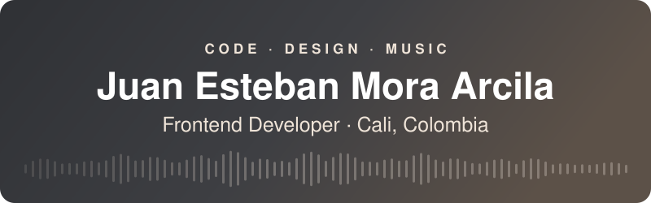
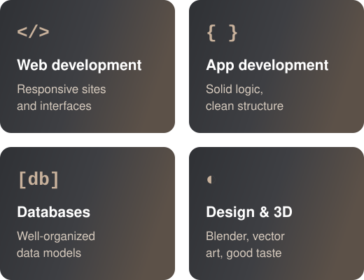

  

  
  
  

  

  

  <b>I'm Juan, a frontend developer and software development technician trained at SENA.</b> 
  I build websites and apps that are clear, useful and look good on any screen.

  I've worked alongside marketing teams and with other developers on freelance projects,
  so I adapt fast to new teams and tools. Outside of code I'm a musician and a music student.

  

  

  

  

<!-- LATEST-REPOS:START -->
<table>
  <tr>
    <td width="50%" valign="top"><a href="https://github.com/JuanMora1945/jhankbass-portfolio"><b>jhankbass-portfolio</b></a> Portfolio landing for bassist Jhankarlo Bermúdez (Jhank Bass). Live: https://jhankbass.netlify.app Updated Nov 2026 · HTML · <a href="https://jhankbass.netlify.app">live demo</a></td>
    <td width="50%" valign="top"><a href="https://github.com/JuanMora1945/aventureros-ecoturismo"><b>aventureros-ecoturismo</b></a> Landing page for an eco-travel agency in Cali, Colombia Updated Nov 2026 · HTML · <a href="https://aventureros-ecoturismo.netlify.app">live demo</a></td>
  </tr>
</table>
<!-- LATEST-REPOS:END -->

  

  Looking for a frontend or web developer? Send me a message on
  <a href="https://www.linkedin.com/in/juan-esteban-mora-arcila-9a0b931ab/">LinkedIn</a>.

